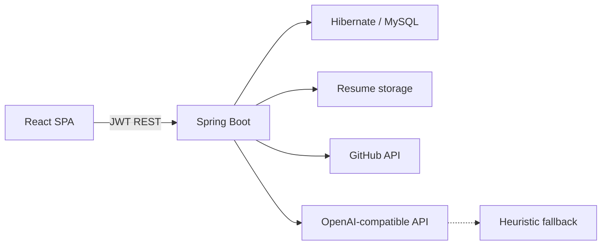

# ProofNexa AI

**Beyond Resumes. Prove Your Potential.**

AI-powered recruitment, skill verification, and developer career growth. The running codebase still uses the Java package `com.proofora` and the MySQL database name `proofora` so existing local data keeps working.

Built with Java 17, Spring Boot, Hibernate / Spring Data JPA, React, JavaScript, HTML5, CSS3, MySQL, REST, Git, and GitHub.

ProofNexa AI is a portfolio-grade recruitment platform with two flagship engines:

1. **AI Skill Proof & Career Growth** — GitHub evidence, missing skills, roadmaps, challenges  
2. **AI Skill Depth & Project Quality Analyzer** — architecture, maintainability, security patterns, tests, data design  

Candidate code is **inspected, never executed**.

## Architecture



| Layer | Path | Role |
| --- | --- | --- |
| UI | `frontend/src` | Candidate, recruiter, admin dashboards |
| API | `backend/src/main/java/com/proofora/web` | REST controllers |
| Domain | `backend/.../domain` | JPA entities |
| AI | `backend/.../ai/AiGateway.java` | Live model or heuristic |
| Security | `backend/.../security` | JWT, roles, CORS |

## How to run

### 1. API

Local startup uses a file database in `backend/data`. MySQL on this machine does not have the `proofora` account, and Docker is not required.

```powershell
cd backend
mvn spring-boot:run
```

Swagger: [http://localhost:8080/swagger-ui.html](http://localhost:8080/swagger-ui.html)

To use MySQL instead, set `SPRING_DATASOURCE_URL`, `SPRING_DATASOURCE_USERNAME`, and `SPRING_DATASOURCE_PASSWORD`. `docker compose up` does that for the API container. The database name stays `proofora`.

### 3. Web

```powershell
cd frontend
npm install
npm run dev
```

Open [http://localhost:5173](http://localhost:5173)

### Demo logins

All passwords: `Password123!`

- Candidate: `alex@proofora.dev` — Alex Rivera in Bengaluru. Resume skills, applications to two jobs, a sample GitHub project with file evidence, a stored quality report, a roadmap, one finished challenge, and one open challenge.
- Recruiter: `maya@proofora.dev` — Maya Chen, Northwind Labs. Three open jobs. Alex’s applications are on the hiring desk. Platform Intern has no application, so you can apply as Alex.
- Admin: `admin@proofora.dev` — Amina Shah. User list, audit log, and analytics.

These rows are created on API startup when Alex has no applications yet. Other accounts you register are left alone.

### Live AI

Set `OPENAI_API_KEY` (and optionally `OPENAI_BASE_URL` / `OPENAI_MODEL`).  
Without a key, resume extraction, gaps, roadmaps, and quality reports still run on deterministic analyzers.

Optional `GITHUB_TOKEN` raises GitHub API rate limits.

Password reset stores a hashed single-use token. Email delivery is not configured. Set `PROOFORA_EXPOSE_RESET_TOKEN=true` only on a local machine if you need the forgot-password response to include the token. Login allows 8 failures per email in a 15-minute window, then returns HTTP 429. Deactivated accounts cannot sign in or use an existing JWT.

## First place to change

Start in [`frontend/src/pages/Landing.jsx`](frontend/src/pages/Landing.jsx) and [`backend/src/main/java/com/proofora/config/DataSeeder.java`](backend/src/main/java/com/proofora/config/DataSeeder.java) — copy and seed data make the product yours in minutes. Next, extend prompts in `AiGateway` call sites under `service/`.

## Tests

```powershell
cd backend; mvn test
cd frontend; npm test
```

`mvn` may not be on PATH. This machine used IntelliJ's bundled Maven. Frontend tests run with `vitest run`.

## Docker (full stack)

```powershell
docker compose up --build
```

Web on `5173`, API on `8080`.

## Roadmap status

See [ROADMAP.md](ROADMAP.md) and [IMPLEMENTATION_PLAN.md](IMPLEMENTATION_PLAN.md). Checked roadmap items are a working vertical slice, not the full master specification. Phase 1 authentication now includes password strength, reset tokens, login rate limits, and account deactivation. Email delivery, Flyway, and cloud hosting are still open.
